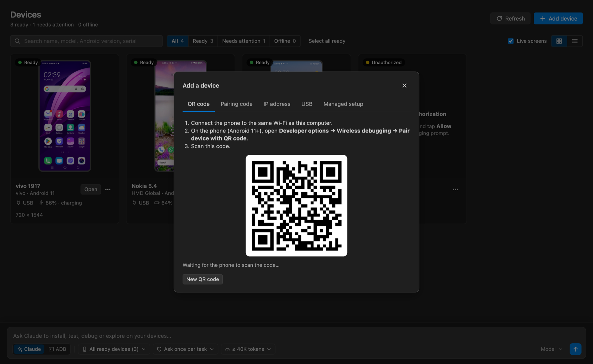

# Pair and connect

## Wireless pairing with QR

Run **MoTA: Pair Device with QR** from the Command Palette. On the phone, enable Developer options and Wireless debugging, then choose **Pair device with QR code**. Scan the displayed code.

- Keep the phone and the machine running this extension on the same Wi-Fi network.
- Codes expire after two minutes; closing the panel stops discovery.
- Pairing credentials are ephemeral and are never saved in extension settings.

ADB uses mDNS to discover the pairing endpoint and automatically connects after successful pairing.

<figure markdown="span">
  
  <figcaption><b>Add device</b> in the farm: QR code, pairing code, IP address, USB and managed setup.</figcaption>
</figure>

## Connect by address

If the device does not appear, run **MoTA: Connect by Address** and enter the IP and port from the main Wireless debugging screen. That connection port differs from the pairing port.

If discovery fails, check firewall rules, multicast support and network client isolation. With Remote SSH/containers, ADB runs on the remote extension host, which needs network access to the phone.

## USB

Enable USB debugging and accept the phone's authorization prompt. Offline and unauthorized devices remain visible but cannot be selected for operations.

## Remembered connections

Successful connection addresses, discovered device identities and selected targets are stored locally in VS Code extension global state. Previously seen devices stay in the sidebar as **remembered** when disconnected; click a saved wireless address to reconnect, or reconnect USB physically. Only ready devices can be selected for installs, logs or monitoring.

Ports can change, so recent addresses are suggestions rather than automatic reconnections. Run **MoTA: Forget Connection History** to clear saved addresses, device history and target selections. Pairing secrets are never stored.
