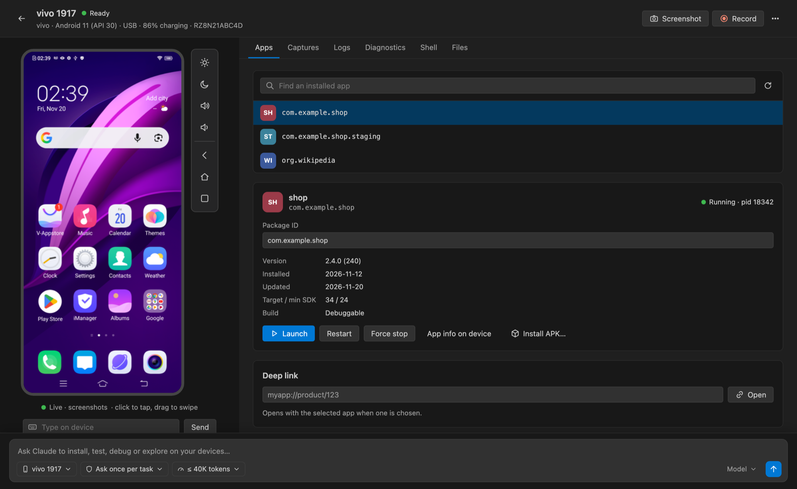

# Device control page

Click a ready device in the Devices list, or run **MoTA: Device Controls**. The page groups **Capture**, **Apps & deep links**, **Input**, **Diagnostics**, and **ADB & files**.

<figure markdown="span">
  
  <figcaption>A device page: live screen with hardware buttons on the left, tools in tabs on the right.</figcaption>
</figure>

## Live view

The live view streams the device screen. By default it uses scrcpy; set [`mota.liveEngine`](settings.md) to `screenrecord` to fall back to Android's built-in recorder.

While you tap, type or press keys here, AI sessions using this phone are warned that you are using it. They are not stopped. See [Share phones between AI sessions](sharing-phones.md#when-you-use-a-phone-yourself).

## Capture

- Capture screenshots without a helper, copy them as PNG images, or save them.
- Screen recording uses helper 0.2.2 and Android capture consent; capture can pause/resume into one MP4.
- Finished videos have playback/pause, seeking, PNG frame copy and frame save controls.

Copy works through the webview image clipboard with a native desktop fallback; Linux fallback needs `wl-copy` or `xclip`. Remote hosts may require saving an image for local copying.

## Apps, input and files

- Deep links accept an optional package and preserve URI query parameters.
- App controls support launch, force stop, install, clear data and uninstall; destructive presets ask for confirmation.
- Device inputs include navigation, volume, wake/sleep, taps, swipes and basic text.
- Diagnostics reuse [logcat and live stats](logs-and-performance.md).
- The **Pressure** card on the Diagnostics tab fills storage and runs load apps, and a banner on every tab warns while pressure is on. See [Test under storage and memory pressure](pressure.md#see-and-stop-pressure).
- File actions push/pull a chosen file.
- The advanced runner accepts Android shell commands or device-scoped ADB arguments; it always fixes the selected serial and never invokes a host shell. An interactive device shell is available for long-running work.

## Notes

Video capture is separate from input [record/replay](recordings.md). The page owns only the screen capture it started and cancels it when closed. Captures stay in extension storage until explicitly saved elsewhere. Protected screens can block capture; H.264 playback depends on the VS Code build. If frame copying is attempted while seeking, wait for the seek to finish first.
