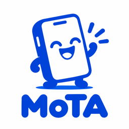
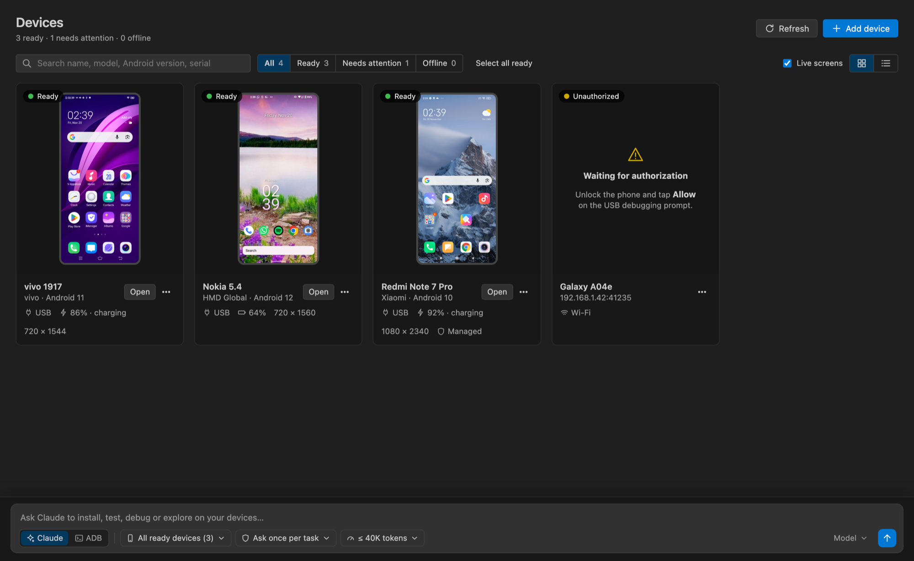

# MoTA Android

{ .mota-hero }

MoTA is a desktop VS Code extension for Android and React Native projects. It turns the phones connected to your computer into a small device farm: pair them, install builds, watch logs and performance, record and replay input, run Maestro tests across devices, and let Claude (or any MCP-capable agent) drive them.

<figure markdown="span">
  
  <figcaption>The device farm, with live screens from connected phones.</figcaption>
</figure>

-   :material-qrcode-scan: **[Pair and connect](connecting.md)**

    QR pairing through Android wireless debugging, plus USB and emulators.

-   :material-package-down: **[Install APKs](install.md)**

    Install one APK on many devices at once, with guided recovery when it fails.

-   :material-test-tube: **[Maestro test runs](maestro.md)**

    Run every selected flow on every selected device and see why failures happened.

-   :material-robot-outline: **[Claude assistant](ai-assistant.md)**

    Ask Claude to explore the app, diagnose failures or write flows, using your local Claude Code.

## Features

- QR pairing through Android wireless debugging (Android 11+).
- USB, wireless and emulator devices in an Explorer sidebar.
- Workspace APK discovery, including `android/app/build/outputs/apk`.
- Install an APK on multiple selected devices concurrently.
- Separate logcat output channels per device, with tag/priority filters.
- Live multi-device battery, Android version, model, memory and CPU reports.
- Optional package-specific memory and cumulative frame rendering diagnostics.
- Device control page with screenshots, screen video, deep links, input and file transfer.
- Input recording and replay through the MoTA helper app.
- Maestro test runs across devices with JUnit-backed results.
- A Claude assistant, and an MCP server so other agents can use the same tools.

## Requirements

- Desktop VS Code 1.95 or newer, in a trusted workspace. Browser-only VS Code is not supported.
- Android SDK Platform Tools (`adb`).
- Optional: the [Maestro CLI](https://maestro.mobile.dev) for test runs, and [Claude Code](https://claude.com/claude-code) for the assistant.

Next: [Getting started](getting-started.md).
