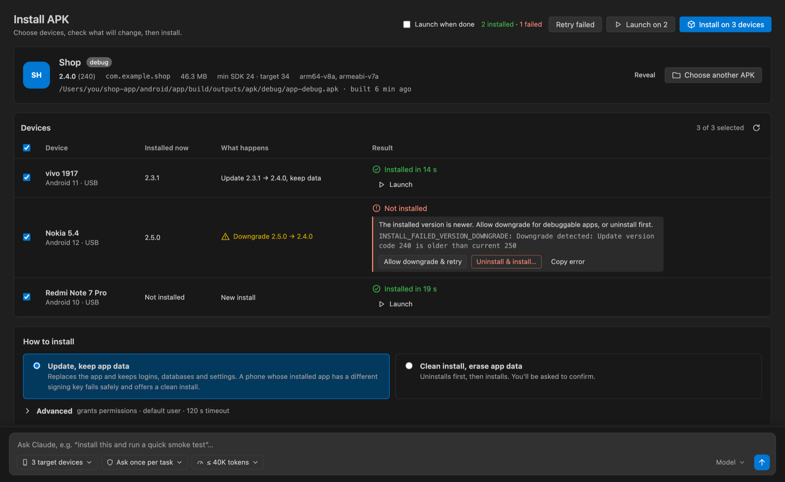

# Install APKs

Build APKs with your project's normal Gradle/React Native workflow; MoTA does not invoke builds. It discovers APKs in the workspace, including `android/app/build/outputs/apk` (see [`mota.apkGlob`](settings.md)).

<figure markdown="span">
  
  <figcaption>Each device shows what will change before installing, and failures offer one-click fixes.</figcaption>
</figure>

## Install on several devices

Click an APK to choose one or more ready devices, or run **MoTA: Install APK on Devices** to browse for one. Choose **Editor page** (the default) for per-device progress and recovery, or **Notification** for compact progress with an **Open install page** action.

Review install options before starting:

- replace while keeping data
- allow test APKs
- permit downgrades for debuggable apps
- grant runtime permissions
- Android user ID
- a 10–600 second timeout

Options are remembered per workspace. Retry runs only on devices that have not succeeded; failures offer tailored guidance, reconnect and ADB settings actions. Standalone APKs are supported; split APK sets and AAB bundles are not.

## Debug/release replacement

The install page includes **Update existing app · keep data** and **Switch debug / release APK** presets. Switching enables replace, test APK and downgrade options; Android still checks signing keys and restricts downgrades of release apps.

## Blocked installs

When an install fails, each affected device offers relevant actions:

- **Replace existing app & retry**
- **Allow downgrade & retry**
- **Allow test APK & retry**
- **Uninstall conflicting app & reinstall**

Successful devices are left alone during targeted retries. **Choose another APK** opens a new installation flow.

## Clean reinstall

**Clean reinstall on selected devices** is available before an install. MoTA reads the application ID with SDK build tools (`aapt` / `aapt2`) when available. Otherwise, enter and verify the package ID; a signature failure can supply the conflicting package ID. A confirmation page lists the exact package and devices and requires acknowledgement of data deletion. It then runs uninstall followed by install.

!!! warning
    Clean uninstall applies to all Android users on the targeted device and deletes local app data; selecting an install user does not narrow uninstall scope.

Cancellation makes no device changes. Uninstall failure stops that device before installation; if installation fails after removal, the old app stays removed. MoTA never automatically uninstalls just because installation failed.
