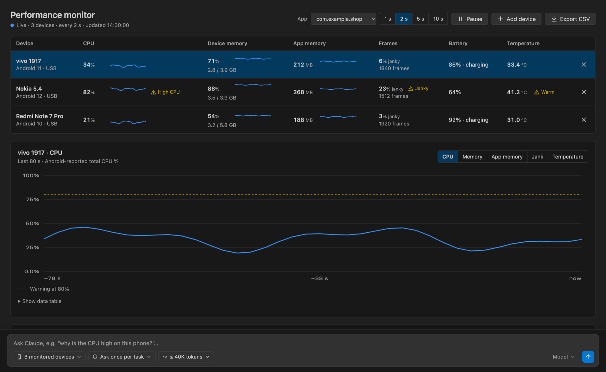

# Logs and performance

## Logcat

Run **MoTA: Start Logcat** to select multiple devices, or use a device's context menu. Output channels keep each device's stream separate.

- The default filter is `*:I`. React Native users can use `ReactNative:V ReactNativeJS:V *:S`.
- You can also choose output format, log buffer, previous line count and an optional app package.
- App filtering follows the current PID; restart logcat after the app restarts.
- The last tag filter and package are remembered.

Run **MoTA: Stop All Logcat Streams** to stop them.

## Device info and live stats

Run **MoTA: Device Info and Live Stats**, or use the **dashboard** icon in the Devices header, and optionally enter your app's package ID. The monitor shows battery, temperature, CPU, memory, app memory and janky-frame values for each device, with trend lines and warning flags. Select a device to see a history chart of CPU, memory, app memory, jank or temperature over the last 60 samples, and use **Export CSV** to save every sample.

<figure markdown="span">
  
  <figcaption>One row per device; the Nokia is flagged for high CPU, jank and temperature.</figcaption>
</figure>

Change the app package and sampling interval (1, 2, 5 or 10 seconds) inside the page; pause/resume or refresh manually. Raw diagnostics are available in expandable details. Missing metrics display as unavailable. The app package is remembered per workspace.

| Metric | Source |
| --- | --- |
| CPU | `dumpsys cpuinfo` |
| Memory | `/proc/meminfo` and `dumpsys meminfo` |
| Frames | `dumpsys gfxinfo` |

These are Android diagnostics, not a precise real-time FPS profiler. Availability and format vary by device and Android version. No root access is requested.
