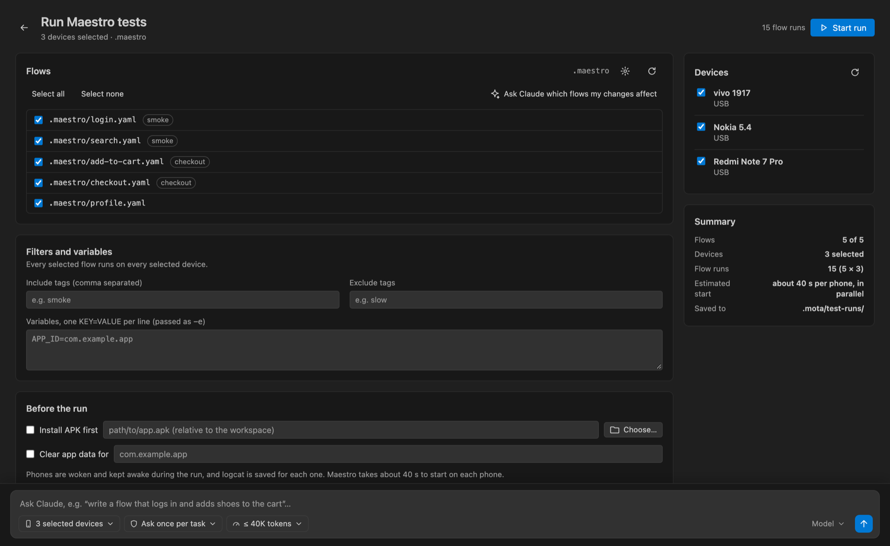
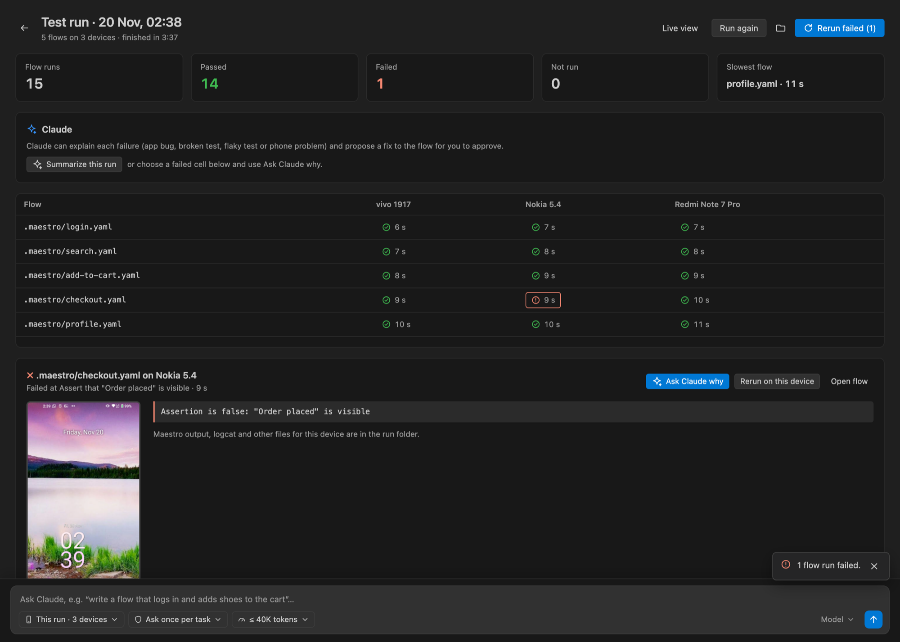

# Maestro test runs

## Set up

Install the [Maestro CLI](https://maestro.mobile.dev) first. MoTA uses `~/.maestro/bin/maestro`, the `maestro` command on PATH, or [`mota.maestroPath`](settings.md).

Put your Maestro flows in `.maestro/` (or set [`mota.maestroFlowsFolder`](settings.md)). MoTA lists the top-level flows, or the ones matched by `flows:` in `config.yaml`, with their tags.

## Run

<figure markdown="span">
  
  <figcaption>Pick flows and devices; every selected flow runs on every selected device.</figcaption>
</figure>

Select devices and flows and run them: every selected flow runs on every selected device.

- Each device gets one Maestro process, which takes about 40 seconds to start before the first flow.
- Progress comes from Maestro's output, and the final result for each flow comes from its JUnit report.
- Failures show the failed step, its error and a screenshot.
- A device that disconnects is marked as lost, and its remaining flows are marked as not run.
- Cancel stops the whole Maestro process tree.
- While a run is on a phone, AI sessions can't change that phone. The same goes for Maestro commands you start from a terminal. See [Share phones between AI sessions](sharing-phones.md).

## Results

<figure markdown="span">
  
  <figcaption>The results grid. Selecting a failed cell shows the failed step, the error and a screenshot.</figcaption>
</figure>

Runs are saved in `.mota/test-runs/<run>/<device>/`:

| File | Contents |
| --- | --- |
| `report.xml` | JUnit report |
| `maestro-console.log` | Maestro's console output |
| `results.json` | MoTA's per-flow results |
| `artifacts/` | Screenshots, screen hierarchy, device log and `commands.json` |

After each run, MoTA stops Maestro's driver app on the phone so that MoTA's own UI tools can use UI automation again.
